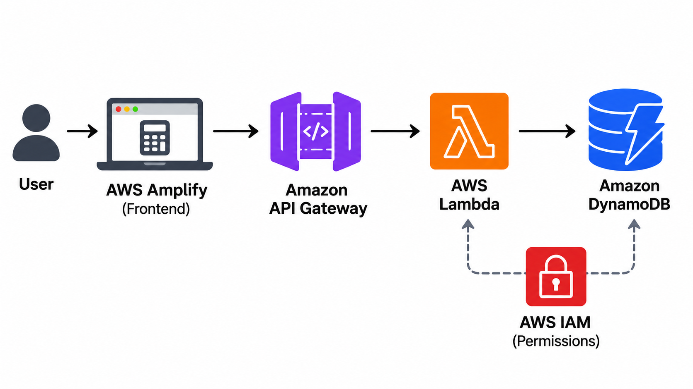
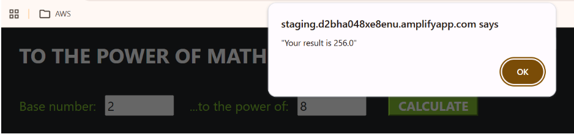

# End-to-End Web Application: Power of Math

A serverless web application built using AWS services that allows users to calculate mathematical powers (exponents) through a simple web interface. The application processes calculations using AWS Lambda and stores the results in Amazon DynamoDB.

## Project Overview

**Power of Math** is an end-to-end serverless application that demonstrates how different AWS services work together to build, deploy, and host a functional web application.

Users can enter a base number and an exponent through a webpage. The application sends the input to an API, invokes an AWS Lambda function to perform the calculation, and stores the result in DynamoDB.

## AWS Services Used

| AWS Service | Purpose |
|---|---|
| **AWS Amplify** | Builds and hosts the frontend web application. |
| **AWS Lambda** | Executes Python code to calculate mathematical powers without managing servers. |
| **Amazon API Gateway** | Creates a REST API to receive HTTP POST requests and invoke Lambda. |
| **Amazon DynamoDB** | Stores mathematical calculation results and timestamps in a NoSQL database. |
| **AWS IAM** | Manages permissions and grants Lambda access to DynamoDB through an execution role and inline policy. |

## Architecture Overview

The application follows a serverless architecture using AWS services.



### Architecture Components

1. **User:** Accesses the web application through a browser.
2. **AWS Amplify:** Hosts the frontend web application.
3. **Amazon API Gateway:** Receives HTTP POST requests from the frontend.
4. **AWS Lambda:** Executes Python code to perform mathematical calculations.
5. **Amazon DynamoDB:** Stores calculation results and timestamps.
6. **AWS IAM:** Controls Lambda permissions to access DynamoDB.

## Application Features

- Simple and user-friendly web interface.
- Accepts base and exponent values as user input.
- Performs mathematical power calculations using Python.
- Uses REST API integration to communicate between frontend and backend.
- Stores calculation results in Amazon DynamoDB.
- Uses serverless AWS services without managing underlying servers.

## Technologies Used

- **Frontend:** HTML, CSS, JavaScript
- **Backend:** Python
- **Cloud Platform:** Amazon Web Services (AWS)
- **API:** REST API
- **Database:** Amazon DynamoDB
- **Architecture:** Serverless Computing

## AWS Configuration

| Component | Configuration |
|---|---|
| Amplify App | PowerOfMath2 |
| Lambda Function | PowerOfMathFunction2 |
| API Gateway | PowerOfMathAPI2 |
| API Method | POST |
| Deployment Stage | Dev |
| DynamoDB Table | PowerOfMatchDatabase2 |
| DynamoDB Partition Key | ID (String) |
| IAM Policy | PowerOfMathDynamoPolicy |
| AWS Region | ap-east-1 |

## API Endpoint

**Method:** `POST`

**Endpoint:**

```text
https://qqo5cd1v50.execute-api.ap-east-1.amazonaws.com/dev
```

**Request Body:**

```json
{
  "base": 2,
  "exponent": 8
}
```

**Expected Response:**

```json
{
  "statusCode": 200,
  "body": "\"Your result is 256.0\""
}
```

## Database Structure

Amazon DynamoDB stores the calculation results using the following attributes:

| Attribute | Description |
|---|---|
| ID | Partition key containing the calculated result. |
| LatestGreetingTime | Timestamp indicating when the calculation was performed. |

**Example Database Item:**

```json
{
  "ID": "256.0",
  "LatestGreetingTime": "Example timestamp"
}
```

## Expected Application Output

**Example Calculation:**

- Base number: `2`
- Exponent: `8`
- Mathematical operation: `2⁸`

**Result:**

```text
Your result is 256.0
```

The calculation result is also stored in Amazon DynamoDB for verification.

## Project Results

The application was successfully deployed and tested using AWS Amplify, Amazon API Gateway, AWS Lambda, and Amazon DynamoDB.

The final application allows users to submit mathematical calculations through the web interface and receive the computed result.

### Final Application Output



**Test Scenario:**

| Input | Value |
|---|---|
| Base Number | 2 |
| Exponent | 8 |
| Expected Result | 256.0 |

**Outcome:** Successfully calculated the mathematical result and stored the corresponding data in Amazon DynamoDB.

## Project Objectives

Through this project, I gained practical experience in:

- Building and hosting a web application using AWS Amplify.
- Developing serverless backend functionality using AWS Lambda and Python.
- Creating and integrating REST APIs using Amazon API Gateway.
- Storing application data using Amazon DynamoDB.
- Configuring IAM execution roles and permissions.
- Understanding how multiple AWS services integrate to form an end-to-end serverless application.

## Security Considerations

- IAM execution roles control Lambda's access to AWS resources.
- DynamoDB permissions should follow the principle of least privilege.
- API Gateway should implement appropriate access controls and request validation before production deployment.
- Avoid exposing sensitive AWS account information or credentials in publicly accessible repositories.

---

**Project:** End-to-End Web Application – Power of Math  
**Cloud Provider:** Amazon Web Services (AWS)  
**Architecture:** Serverless Web Application
